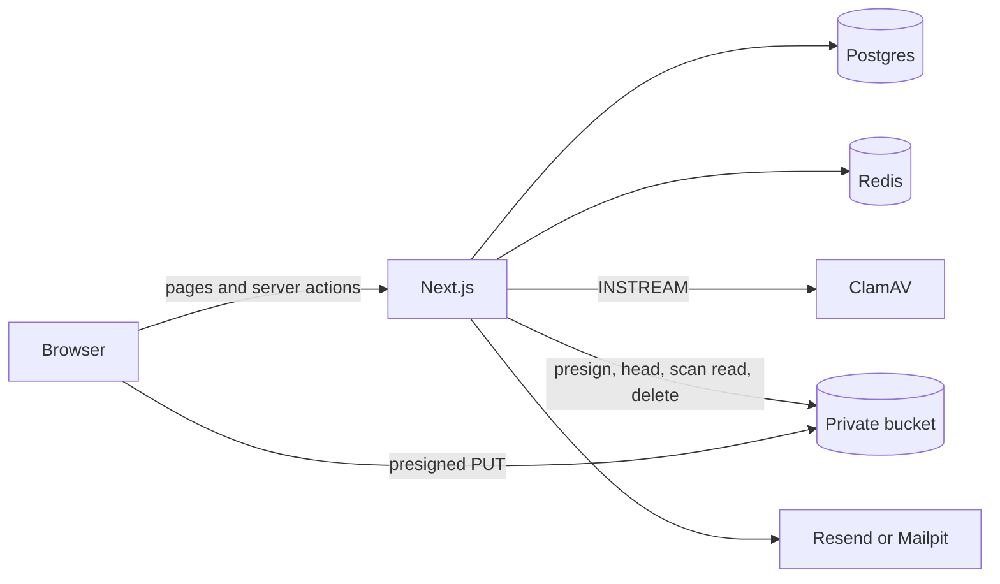

<div align="center">
  
  <div>
    
    
    
    
    
    
  </div>

  <h3 align="center">Private file storage with a real backend shape</h3>
</div>

StoreIt is a full-stack file storage product: email OTP sign-in, direct-to-bucket uploads, per-user quotas, malware scanning, sharing, and signed access to a private bucket. The UI is familiar; the interesting part is the **infrastructure** behind it — how Postgres, Redis, object storage, ClamAV, and mail work together without putting file bytes through the app server.

This README is written for two audiences: anyone cloning the repo, and anyone reviewing the system design (including interview walkthroughs).

---

## What you can demo

- **Email OTP auth** — no passwords; short-lived codes; sessions hashed in Postgres
- **Direct uploads** — browser → private bucket via presigned PUT (app never streams the upload body)
- **Quota enforcement** — in-flight + stored bytes checked before a upload is allowed
- **Malware gate** — ClamAV scans after the object lands; infected files never appear in the library
- **Private bucket** — view/download only through short-lived signed URLs
- **Sharing** — owner grants view (and optional rename/delete) by email
- **Dashboard** — usage by type, recent files, search with trigram indexing
- **Background hygiene** — sweep job for expired unfinished uploads and retryable object deletes

---

## Infrastructure (the core of the design)

Local development runs the supporting services with Docker Compose. Production uses the same contracts with managed or self-hosted equivalents (for example Cloudflare R2 instead of MinIO, Resend instead of Mailpit).

| Role | Local | Production (typical) |
| --- | --- | --- |
| App | Next.js 15 (App Router) + React 19 | Same app process |
| Catalog & sessions | PostgreSQL 16 | Managed or self-hosted Postgres |
| OTP challenges & email rate limits | Redis 7 | Managed or self-hosted Redis |
| Object bytes | MinIO (S3 API) | Cloudflare R2 or any S3-compatible store |
| Malware scan | ClamAV (`clamd` INSTREAM) | Same image/service beside the app |
| Auth email | Mailpit | Resend (verified domain) |
| Cleanup | Manual / cron → `POST /api/cron/sweep` | Scheduled HTTP call with `CRON_SECRET` |



**Responsibilities stay split on purpose:**

- **Postgres** is the source of truth for users, sessions, files, shares, pending uploads, and deletion intents.
- **Redis** holds only ephemeral auth challenges and send rate limits — a Redis restart must not sign everyone out.
- **The bucket** holds bytes. Keys look like `owners/{ownerId}/{fileId}`. Renames change the catalog name only.
- **ClamAV** is never on the hot upload path from the browser. The app streams the object from the bucket into `clamd` during `completeUpload`.
- **Mail** is outbound only. Dev always uses Mailpit; production uses Resend when configured.

---

## Why these decisions

These are the talking points that explain the shape of the system — not “framework of the week,” but tradeoffs you can defend.

| Decision | Reason |
| --- | --- |
| Presigned PUT to the bucket | Keeps multi‑MB uploads off the Next.js process; the server action body limit is not the upload limit (50 MB per file). |
| Scan after PUT, before listing | The library only shows objects that passed ClamAV. A scanner outage refuses completion instead of storing an unchecked file. |
| Private bucket + signed URLs | No public object URLs. SVG/HTML are signed as downloads so the browser does not render untrusted markup from the bucket origin. |
| OTP instead of passwords | Removes password storage and reset flows; rate limits and attempt burns still apply. |
| Sessions in Postgres, challenges in Redis | Durable login vs cheap, short-lived verification state. |
| `pending_uploads` + `object_deletions` | There is no 2PC between Postgres and S3. Commit catalog intent, then perform the external call; sweep repairs abandoned PUTs. |
| Quota checked under a user-row lock | Prevents concurrent uploads from overshooting `STORAGE_QUOTA_BYTES` (default 2 GB). |
| S3-compatible API | Same code path for MinIO locally and R2 (or other S3) in production. |

---

## Stack and code map

- **UI / routing:** `app/`, `components/`
- **Mutations:** server actions in `lib/actions/`
- **Auth:** `lib/auth.ts`, `lib/actions/user.actions.ts`, `lib/challenges.ts`, `lib/rate-limit.ts`
- **Storage & scan:** `lib/storage.ts`, `lib/scanner.ts`, `lib/actions/file.actions.ts`, `lib/quota.ts`
- **Retention / sweep:** `lib/object-retention.ts`, `scripts/sweep.ts`, `app/api/cron/sweep/route.ts`
- **Schema:** `docker/postgres/init.sql`
- **Local infra:** `docker-compose.yml`
- **Env template:** `.env.example`

| Concern | File |
| --- | --- |
| Sign-in, sessions, OTP | `lib/auth.ts`, `lib/actions/user.actions.ts` |
| Challenges and rate limits | `lib/challenges.ts`, `lib/rate-limit.ts`, `lib/redis.ts` |
| Sign-in email | `lib/mail.ts` |
| Upload, list, rename, share, delete | `lib/actions/file.actions.ts` |
| Bucket client and signed URLs | `lib/storage.ts` |
| Malware scan | `lib/scanner.ts` |
| Quota | `lib/quota.ts` |
| Failed deletes and expired uploads | `lib/object-retention.ts`, `scripts/sweep.ts`, `app/api/cron/sweep/route.ts` |
| Schema | `docker/postgres/init.sql` |
| Local services | `docker-compose.yml` |

`FileDocument` in `types/index.d.ts` is the shape the UI expects (`$id`, `$createdAt`, `owner`, `users`, `url`, `downloadUrl`). Actions map database rows into that shape.

---

## Sign-in flow

1. The person enters an email. `beginLogin` stores a short-lived challenge in Redis and returns its id to the browser (not the user id).
2. Unknown email → sign-up form for that address. Existing account → 6-digit code emailed. Resend replaces the code. Redis allows 5 sends per email per 15 minutes.
3. An existing email on the sign-up form is treated as sign-in; the response does not advertise that the account already exists.
4. `verifySecret` validates the code. Five wrong attempts delete the challenge. Success creates a `sessions` row and sets the httpOnly `storeit-session` cookie. Only a hash of the token is stored.
5. Sign out deletes the current session; sign out everywhere deletes all sessions for that user.

OTP and session token hashes use SHA-256 (OTP keyed with `AUTH_SECRET`). Codes expire after 10 minutes. Sessions last 30 days.

---

## Upload flow

1. `createUpload` locks the user row, sums stored + in-flight sizes, and refuses the request if it would exceed quota. It inserts `pending_uploads` (1 hour TTL) and returns a presigned PUT.
2. The browser uploads directly to the bucket.
3. `completeUpload` verifies size, streams the object to ClamAV, then inserts the `files` row and removes the pending row. Infected objects are deleted and never listed. If the scanner is unreachable, completion fails and the pending upload can be retried.

Sharing stores recipients in `file_access`. View is always on; rename and delete are optional privileges. Only the owner can share.

---

## Opening a file

`getFiles` loads rows from Postgres; `fileAccessUrls` signs view and download URLs (one hour). Search uses `ILIKE` with a `pg_trgm` index on the file name.

---

## Local setup

You need Git, Node.js, [bun](https://bun.sh), and Docker.

```bash
git clone https://github.com/d-code-h/storeit.git
cd storeit
bun install
cp .env.example .env.local
openssl rand -hex 32
```

Put the generated value in `AUTH_SECRET` and another in `CRON_SECRET`. Then:

```bash
docker compose up -d
bun dev
```

Open [http://localhost:3000](http://localhost:3000).

Compose publishes non-default host ports so they are less likely to collide on a shared machine:

| Service | Address |
| --- | --- |
| Postgres | `localhost:5436` |
| Redis | `localhost:6380` |
| MinIO API | `http://127.0.0.1:9010` |
| MinIO console | [http://localhost:9011](http://localhost:9011) |
| ClamAV | `localhost:3310` |
| Mailpit inbox | [http://localhost:8026](http://localhost:8026) |

ClamAV downloads virus definitions on first start. Wait until the container is healthy before expecting scans to succeed. The `storeit` bucket is created on first use. Do not commit `.env.local`.

---

## Email

`lib/mail.ts` sends HTML plus a plain-text alternative.

- **Development:** always Mailpit ([http://localhost:8026](http://localhost:8026)); the code is also printed in the server log. `RESEND_API_KEY` is ignored until `NODE_ENV=production`.
- **Production:** Resend when `RESEND_API_KEY` is set. Verify a domain, then set `MAIL_FROM` to an address on that domain. Leaving the Mailpit-style `noreply@storeit.local` in production falls back to Resend’s onboarding sender, which only reaches the account address.

---

## Deploy checklist

1. Set `AUTH_SECRET`, `CRON_SECRET`, `DATABASE_URL`, `REDIS_URL`, and `NEXT_PUBLIC_APP_URL`.
2. Point `S3_*` at the production bucket (R2 or other S3). Keep `S3_FORCE_PATH_STYLE=true` so signed URL hosts match the endpoint. Allow the app origin for `PUT`, `GET`, and `HEAD` in bucket CORS.
3. Run ClamAV beside the app. Set `CLAMAV_HOST` / `CLAMAV_PORT` to a hostname that resolves **on the app container’s Docker network** (not `127.0.0.1` unless the app and `clamd` share a network namespace). Compose service names only resolve on the compose network they were attached to; if the app sits on a shared platform network, use a name (or alias) that exists there.
4. Configure Resend (`RESEND_API_KEY`, `MAIL_FROM`).
5. Schedule cleanup about once an hour: `POST /api/cron/sweep` with `Authorization: Bearer <CRON_SECRET>`. Equivalent CLI: `bun run maintenance:sweep`.
6. Schedule Postgres dumps (`bun run db:backup` or `pg_dump -Fc`). Keep dumps off the app disk alone. Object bytes remain in the bucket.

Community MinIO does not implement per-bucket CORS; local compose sets `MINIO_API_CORS_ALLOW_ORIGIN` for `localhost:3000`. The AWS SDK checksum mode is `WHEN_REQUIRED` because R2 rejects the SDK’s default CRC32 headers.

---

## Transactions and leftover objects

Postgres transactions cover rows that change together. They do not cover the browser or the bucket.

- Starting an upload: lock user, check quota, insert `pending_uploads` in one transaction; then create the presigned URL. If signing fails, delete the pending row.
- Finishing an upload: insert `files` and delete the pending row under an advisory lock on the object key.
- Deleting a file: remove `files` and insert `object_deletions` in one transaction; delete bytes after commit.
- Scanner outage does not discard a pending object, so completion can be retried.

There is no two-phase commit between Postgres and S3. The practical order is: commit the source of truth, then perform the external call, and keep a row (`object_deletions` / expired `pending_uploads`) for work that still needs to happen. The sweep covers the case where the browser PUTed an object and never called `completeUpload`.

---

## Cost of the hot paths

- Listing a page signs two URLs per file (local HMAC; no bucket round trip per signature).
- Dashboard usage is one grouped SQL query.
- Session lookup is deduplicated for the request.
- **Finishing an upload is the expensive step:** the server streams bucket → ClamAV. That wait is intentional — the file is not listed until the verdict is in.

---

## Security choices worth naming

- Unknown email on sign-in opens sign-up for that address; a wrong OTP still says the code is invalid.
- Five OTP failures burn the challenge.
- The bucket is private; view and download URLs expire.
- Infected files are deleted; scanner outage refuses completion.
- The sweep route compares the authorization header in constant time and rejects a missing secret.
- Sharing, renaming, and deleting check ownership (or granted privileges) for the session user.
